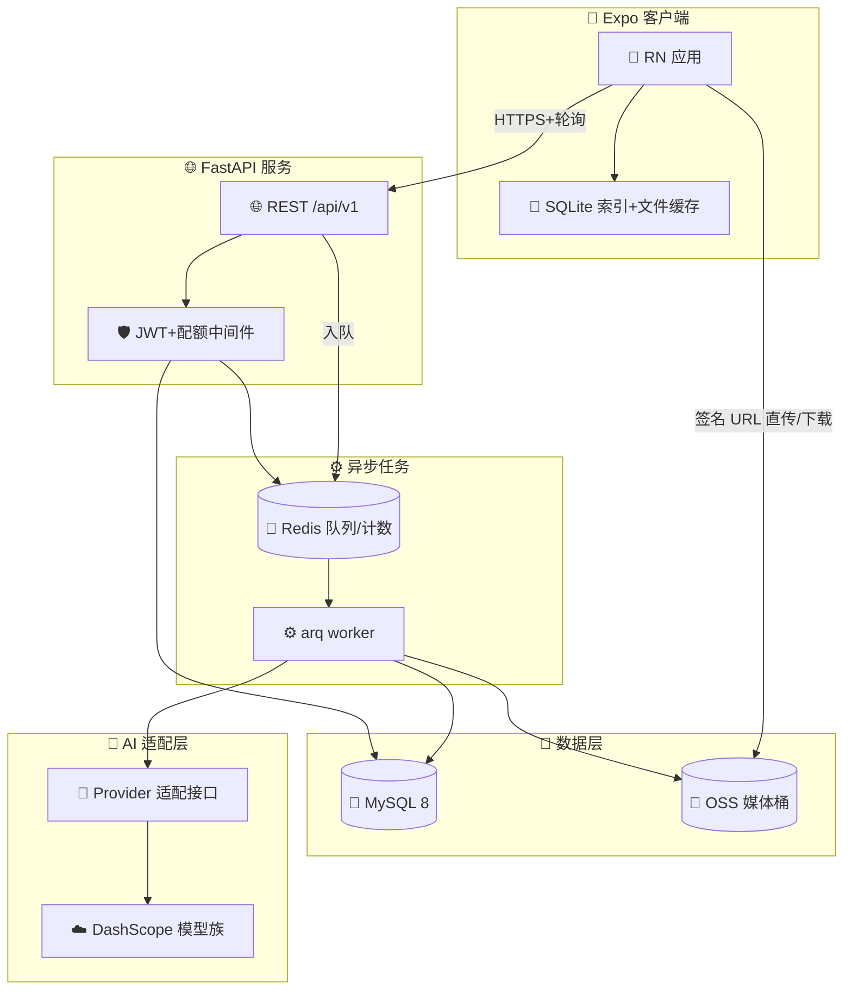
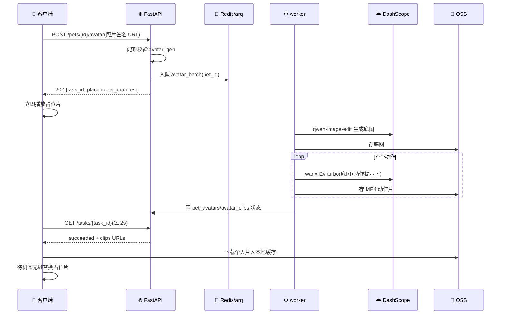
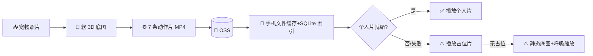
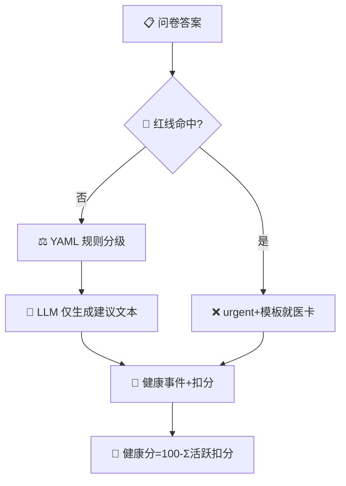
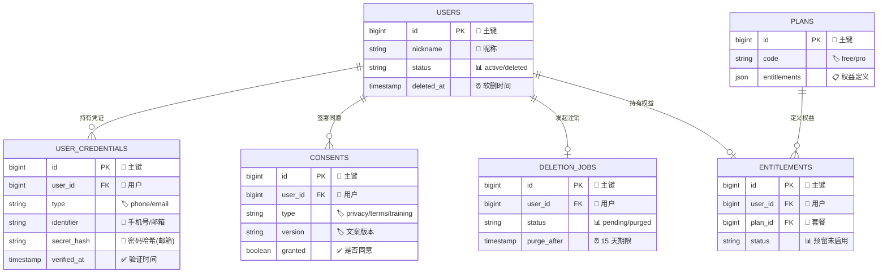
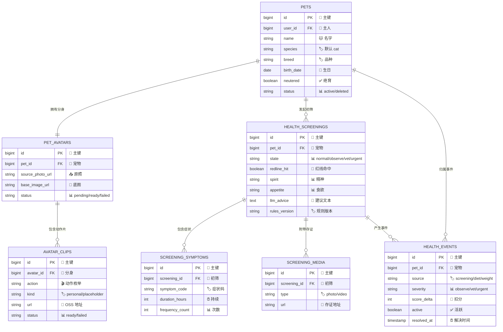
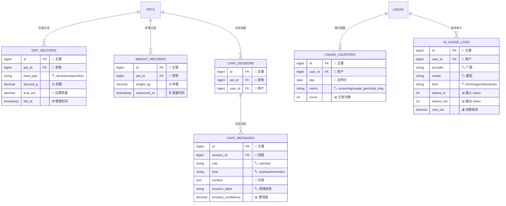

# 绒星(RongXing)系统架构文档

| 项 | 内容 |
| --- | --- |
| 文档版本 | v1.0(共识锁定稿) |
| 日期 | 2026-11-16 |
| 关联文档 | `product/PRD.md`(产品定义)、`product/FRD.md`(功能点与验收标准、症状/映射附录) |
| 技术栈 | FastAPI + React Native(Expo)+ reicon-react-native + MySQL |
| 部署形态 | 内测期单区域云主机 + docker compose;对象存储与 AI 走云服务 |

## 🧱 技术栈总览

| 层 | 选型 | 理由 |
| --- | --- | --- |
| 移动端 | React Native + Expo(SDK 52+) | 双端一套代码;expo-video/expo-sqlite/notifee 生态齐全 |
| 导航/状态 | React Navigation + Zustand | 共识栈;轻量、无 redux 样板 |
| 图标 | reicon-react-native(MIT)[^1] | 用户指定图标库,已核实 RN 包存在 |
| 后端 | FastAPI + Pydantic v2 + SQLAlchemy 2 + Alembic | 异步原生、schema 即文档 |
| 数据库 | MySQL 8 | 共识栈;元数据与结果存储 |
| 队列/缓存 | Redis 7 + arq worker | 轻量异步任务;配额计数与限频共用 Redis |
| 对象存储 | 阿里云 OSS(开发环境 MinIO) | 媒体与动作片;签名 URL 下发 |
| AI 服务 | 通义 DashScope 一家桶 + Provider 适配层 | 单 key 单账单;适配层隔离换厂商 |
| 本地存储 | expo-sqlite(索引/缓存)+ expo-file-system(资产文件) | SQLite 不存二进制资产,只存索引与元数据 |
| 通知 | notifee 本地通知 | v1 不建服务端推送通道 |

## ☁️ 系统架构



要点:客户端**不直连 AI**;所有 AI 调用经 worker + 适配层,便于配额、审计、换厂商。媒体走 OSS 签名 URL 直传直下,不经过 API 服务器带宽。

## 📦 后端结构

```text
backend/
  app/
    main.py               # FastAPI 装配、中间件、路由注册
    core/                 # config(Settings)、db、deps、errors、security(JWT)、middleware、observability
    routers/              # auth pets avatars avatar_assets motion tasks media config screening health diet weights chat quota
    schemas/              # Pydantic 请求/响应模型(与 FRD 字段一一对应)
    models/               # SQLAlchemy ORM，按域拆分(user pet task media health tracker chat platform)
    services/             # 领域逻辑：每域一个模块
      triage.py           # 规则引擎:红线判定、分级、健康分计算
      feeding.py          # RER/DER 换算
      chat.py             # 聊天人设 prompt 组装(档案+最新初筛)
      avatars.py          # 底图/动作片编排、占位片 manifest
      motion.py           # 萌化底图+GIF 编排、GIF 规格校验(F14)
      identity.py sessions.py consents.py mail.py mail_worker.py   # 账号、会话、同意、邮件投递
      media.py privacy.py quota.py idempotency.py tasks.py         # 媒体、合规、配额、幂等、任务租约
    providers/            # 适配层:base.py + dashscope.py + fake.py + motion.py(AI 接入点,F14-6)
    worker.py             # arq worker:任务分发、租约清扫、媒体/幂等清理
  rules/                  # symptoms.yaml redlines.yaml action_map.yaml scoring.yaml(版本化)
  migrations/             # Alembic
  scripts/
    build_placeholder_library.py   # 一次性:3 体型×7 动作占位片批量生成
  tests/
```

| 模块 | 职责 | 关键约束 |
| --- | --- | --- |
| routers | HTTP 路由层 | 只做参数校验、鉴权与响应组装;业务规则集中在 services,可独立单测 |
| services/triage.py | 红线 bypass、症状分级、健康分 | 纯函数+YAML 规则,可单测;LLM 不参与分级与打分 |
| services/chat.py | 聊天上下文组装 | 注入档案+最新初筛状态+免责声明;温度与字数上限配置化 |
| providers | LLM/Image/Video/Audio 四接口 | 业务代码只依赖接口;重试/超时/降级在此层 |
| worker.py | 长任务编排 | 幂等键=业务 ID;失败重试≤3;结果写 MySQL+OSS |
| rules | 医学/映射/扣分配置 | 改规则不改代码;版本号随结果存档 |

## 📱 前端结构

```text
app/                      # Expo Router
  (auth)/login.tsx register.tsx bind.tsx
  (tabs)/index.tsx        # 首页:分身+状态卡+健康分+概览
  (tabs)/screen.tsx       # 初筛入口与历史
  (tabs)/chat.tsx         # 聊天窗口
  (tabs)/profile.tsx      # 账号/配额/合规/注销
  pets/[id]/edit.tsx diet.tsx history.tsx feeding.tsx
  screening/[id]/result.tsx
components/
  avatar/AvatarPlayer.tsx # MP4 循环播放+动作状态机+回退链
  avatar/MotionPet.tsx    # GIF 播放+手势互动+健康待机联动(F14)
  MotionStage.tsx         # 动图读取/轮询,不可用回退分身舞台
  screening/... chat/... diet/...
stores/                   # Zustand:session pets health chat quota
lib/
  api.ts                  # fetch 封装+JWT 刷新+错误 envelope
  poller.ts               # 任务轮询 hook(2s/超时兜底)
  db.ts                   # expo-sqlite:asset_index chat_cache retry_queue kv_meta
  assets.ts               # 文件缓存 LRU(默认 200MB)
  notifications.ts        # notifee 复查/喂养提醒
```

| 本地 SQLite 表 | 内容 | 说明 |
| --- | --- | --- |
| asset_index | clip_id、pet_id、action、kind、local_path、bytes、last_used | 资产索引;文件本体在文件系统 |
| chat_cache | 消息镜像(session_id、role、kind、content、created_at) | 弱网可读历史 |
| retry_queue | 待发送请求(method、path、body、attempts) | 浅离线:饮食/聊天发送失败入队重试 |
| kv_meta | 配置版本、占位 manifest 版本、LRU 统计 | 小键值 |

导航与动作播放:`AvatarPlayer` 订阅 health store 与 chat store,按 `product/FRD.md` 附录 C 映射表选 action;映射表来自 `GET /config/action-map`,本地缓存版本号比对更新。

## ⚙️ 异步任务与轮询契约

当前本地实现：`GET /api/v1/tasks/{task_id}` 使用 32 位小写十六进制任务 ID，仅在登录、同意当前协议且任务属于本人活跃猫咪时返回 `{task_id,type,status,result}`，不返回内部输入。数据库按猫咪、任务类型和业务幂等键去重；失败可重新排队或在两次重试耗尽时终止。认领租约为 15 分钟，超期需由调度方再次尝试认领才能回收。以下流程为目标契约；arq、外部生成、上传签名与移动端轮询尚未接入。



| 契约项 | 默认值 |
| --- | --- |
| 轮询间隔 | 2s;页面不可见时暂停 |
| 轮询超时 | avatar_batch 10min;screening_analysis 60s;audio_interpret 45s;gif_export 60s |
| 超时行为 | 停止轮询,展示兜底态+「重试」按钮;任务后台继续,结果可回查 |
| 任务重试 | worker 内单步重试≤2;整任务失败标记 failed,客户端可手动重发 |
| 幂等 | 同一 pet 的 avatar_batch 并发请求返回进行中 task_id |

```mermaid
stateDiagram-v2
    accTitle: Async task lifecycle
    accDescr: Tasks move from pending to running then succeeded or failed; failed tasks accept bounded retries before terminal failure.

    [*] --> pending
    pending --> running
    running --> succeeded
    running --> failed
    failed --> running : 重试≤2
    succeeded --> [*]
    failed --> [*]
```



## 🔌 AI Provider 适配层

```python
class LLMProvider(Protocol):
    async def chat(self, messages: list[Msg], *, temperature: float, max_tokens: int) -> str: ...
class ImageProvider(Protocol):
    async def edit(self, base_image_url: str, prompt: str) -> bytes: ...
class VideoProvider(Protocol):
    async def i2v(self, base_image_url: str, motion_prompt: str, *, seconds: int) -> bytes: ...
class AudioProvider(Protocol):
    async def interpret(self, audio_url: str, prompt: str) -> EmotionResult: ...
```

| 能力 | 默认实现(DashScope) | 备选(适配层可换) |
| --- | --- | --- |
| LLM(初筛建议/聊天人设) | qwen-plus(聊天)/ qwen-max(初筛建议) | 豆包、GLM、DeepSeek |
| 图生图(软 3D 底图) | qwen-image-edit | Seedream/Seededit |
| 图生视频(动作片) | wanx i2v turbo | 可灵 Kling(质量不达标时) |
| 音频情绪解读 | qwen2-audio / qwen-omni | Gemini(海外版预留) |

降级策略:视频模型失败→重试≤2→标记该 action failed→客户端回退占位片;LLM 失败→初筛仍返回规则分级+模板化建议(不空手);音频失败→返回「未识别」情绪+通用安抚回复,不阻塞对话。所有调用写 `ai_usage_logs`(成本审计)。

## 🎨 分身资产管线



- 动作片规格:≤5s、720p、H.264、无声、首尾帧对齐;命名 `{pet_id}/{action}.mp4`。
- 占位片库:`scripts/build_placeholder_library.py` 一次性生成 3 体型×7 动作,manifest 版本化下发;兼作冷启动与永久兜底。
- 替换时机:仅待机态触发替换,淡入淡出 300ms,避免动作中途穿帮。
- 分享导出:`gif_export` 任务将指定 action 的 MP4 转码 GIF(仅导出用,运行时不播 GIF)。
- 萌宠动图(F14,运行时可播 GIF):`motion_batch` 先萌化底图,再逐动作产出 ≤7s 循环 GIF,存 `motions/{pet_id}/{task_id}/{action}.gif`;单动作失败不影响其余,`min_ready` 达标即 `usable`。客户端优先播动图,不可用回退本条回退链。AI 只在 `providers/motion.py` 的 `MotionProvider` 接入,未接入时占位实现离线可跑通。
- 回退链与触发映射的产品验收见 `product/FRD.md` F03、F14 与附录 C。

## ⚖️ 分诊规则引擎与健康分



- 规则文件:`rules/redlines.yaml`(6 红线+派生规则:呕吐持续≥24h)、`rules/symptoms.yaml`(15 症状×追问→severity)、`rules/scoring.yaml`(扣分权重与衰减)、`rules/action_map.yaml`。
- 分级输出状态档:normal / observe / vet / urgent;多症状取**最高档**。
- 健康分:`score = max(0, 100 - Σ 活跃事件扣分)`;observe 事件 72h 无复查自动衰减为 0 分扣但保留记录;无事件且无初筛 → `score = null`(UI「未评估 --」)。
- 每次结果存档 `rules_version`,保证历史可复现。

```mermaid
stateDiagram-v2
    accTitle: Pet health state transitions
    accDescr: Pet health state derives from active events; recheck results resolve or escalate observe states, closing the screening loop.

    [*] --> not_assessed
    not_assessed --> normal : 首次初筛无异常
    not_assessed --> observe : 轻度症状
    not_assessed --> vet : 中度症状
    not_assessed --> urgent : 红线
    observe --> normal : 复查无异常
    observe --> vet : 复查加重
    vet --> normal : 复查/就医反馈好转
    urgent --> vet : 就医后降级
    normal --> observe : 新初筛异常
```



## 💾 数据模型(MySQL)

### ER 一:账号与订阅域



### ER 二:宠物、分身与健康域



### ER 三:记录、聊天与计量域



跨域关系:`PETS.user_id → USERS.id`;`TASKS` 表(id、type、status、payload_json、result_json、retry_count、业务幂等键)独立于业务域,见附录 DDL。完整字段级 DDL 见本文附录 A。

## 🌐 API 设计

本地照片已实现 `POST /media/presign` → 使用签名表单直传 → `POST /media/{id}/complete` → `GET /media/{id}`。签名有效期 10 分钟，使用启用版本控制的 S3 兼容私有桶。服务端复核真实内容后保存 `VersionId`，下载用 60 分钟签名指向该版本。首页将选图状态绑定到当前猫咪；只有 API 返回匹配的 `media_id` 和 `verified` 时才显示验证成功，不把上传当作分身任务。后续业务应收 `media_id`，不接收任意 URL；生产 OSS 适配、视频／音频和存储清理仍是待交付项。

约定:前缀 `/api/v1`;Bearer JWT(access 30min + refresh 30d);错误 envelope `{"code":"QUOTA_EXCEEDED","message":"...","detail":{...}}`;媒体上传先 `POST /media/presign` 取签名直传私有对象存储,业务接口只收已确认的 `media_id`;长任务返回 `202 {task_id}`。

| 分组 | 端点 | 说明 |
| --- | --- | --- |
| 认证 | POST /auth/sms/send | 短信验证码,限频 1/分钟、10/天/号 |
| 认证 | POST /auth/register | phone 或 email 注册,统一账号 |
| 认证 | POST /auth/login | 任一凭证登录 |
| 认证 | POST /auth/refresh | 刷新 access |
| 认证 | POST /auth/credentials/bind | 绑定第二凭证,需验证目标 |
| 账号 | GET/PATCH /me | 资料读取/修改 |
| 账号 | DELETE /me | 注销:级联软删+purge 任务(15 天) |
| 同意 | GET/POST /consents | 隐私/协议/训练授权版本化记录 |
| 媒体 | POST /media/presign | OSS 直传签名 URL(类型/大小校验) |
| 宠物 | GET/POST /pets | 列表/建档(≤5 只/账号) |
| 宠物 | GET/PATCH/DELETE /pets/{id} | 详情/修改/软删 |
| 分身 | POST /pets/{id}/avatar | 触发 avatar_batch(配额 avatar_gen) |
| 分身 | GET /pets/{id}/avatar | 底图+clips+状态 |
| 分身 | GET /avatar/placeholder-manifest | 占位片库版本化清单 |
| 萌宠动图 | POST /pets/{id}/motion | 触发 motion_batch(配额 avatar_gen,与分身共用) |
| 萌宠动图 | GET /pets/{id}/motion | 萌化底图+gifs+状态+配置 |
| 初筛 | POST /pets/{id}/screenings | 问卷+媒体 URL;红线不限额 |
| 初筛 | GET /screenings/{id} | 结果(含 task 状态) |
| 初筛 | GET /pets/{id}/screenings | 历史列表 |
| 初筛 | DELETE /screenings/{id}/media/{mid} | 单条存证删除(同步删 OSS 对象) |
| 健康 | GET /pets/{id}/health | 状态档+健康分+活跃事件+扣分明细 |
| 饮食 | POST/GET /pets/{id}/diet | 快录/按日查询 |
| 饮食 | GET /pets/{id}/feeding-reference | RER/DER 换算参考 |
| 体重 | POST/GET /pets/{id}/weights | 记录/趋势 |
| 聊天 | POST/GET /pets/{id}/chat/sessions | 线程创建/列表 |
| 聊天 | POST /chat/sessions/{sid}/messages | text 同步返回;audio 入队 audio_interpret |
| 聊天 | GET /chat/sessions/{sid}/messages | 分页历史 |
| 任务 | GET /tasks/{id} | 轮询契约见上文 |
| 配额 | GET /quota | 当日用量/上限 |
| 配置 | GET /config/action-map | 动作映射(版本化) |
| 配置 | GET /config/motion | 萌宠动图动作/状态/手势映射(版本化) |
| 配置 | GET /config/symptoms | 症状清单+追问项(版本化) |
| 分享 | POST /pets/{id}/share/gif | gif_export 任务 |
| 订阅 | GET /plans、GET /me/entitlement | 预留只读,不接支付 |

## 🔐 认证、安全与合规实现

- JWT:access 30min、refresh 30d rotating;凭证密码 argon2id;短信码 Redis 5min TTL+限频。
- 授权:所有 pet 资源校验 `pet.user_id == jwt.sub`;跨用户访问统一 404(不泄露存在性)。
- 媒体:OSS 私有桶+签名 URL(上传 10min、下载 60min);视频≤50MB、照片≤10MB、音频≤60s, presign 与 worker 双校验。
- 限频:登录/短信/初筛/聊天分层限频(Redis 滑动窗口);红线初筛只受安全限频不受配额。
- PIPL 注销:`DELETE /me` → 全业务表软删 + 签发 purge_user 任务 → `purge_after = now+15d` 物理删除含 OSS 对象;注销期间账号冻结登录。
- 同意版本化:文案升级后首启重新弹窗;training 同意默认 false,单独弹窗。
- 审计:ai_usage_logs + 结构化日志(request_id、user_id、task_id);不落地明文手机号日志。

## 🚀 部署与环境

| 服务 | 镜像/形态 | 说明 |
| --- | --- | --- |
| api | uvicorn ×2 worker | FastAPI,无状态 |
| worker | arq ×1(可扩) | 长任务;视频生成并发限 2 |
| mysql | MySQL 8 容器/云 RDS | 每日备份 |
| redis | Redis 7 | 队列+计数+限频 |
| minio/oss | 开发 MinIO / 生产 OSS | 媒体桶 |

| 环境变量 | 用途 |
| --- | --- |
| DATABASE_URL / REDIS_URL | 存储与队列连接 |
| MYSQL_DATABASE / MYSQL_USER / MYSQL_PASSWORD / MYSQL_ROOT_PASSWORD | Compose 的 MySQL 容器初始化与容器内连接串生成 |
| MEDIA_S3_ENDPOINT/BUCKET/ACCESS_KEY/SECRET_KEY/REGION | 媒体私有桶(需版本控制) |
| DASHSCOPE_API_KEY | 唯一 AI key(适配层内使用) |
| JWT_SECRET | 会话签名(≥32 字节) |
| PRIVACY_* / TERMS_* | 协议版本与 HTTPS 链接 |
| SMTP_* / VERIFICATION_BASE_URL | 邮箱验证投递 |
| QUOTA_SCREENING / QUOTA_AVATAR / QUOTA_CHAT | 配额默认值,可热调 |
| RULES_DIR | 规则包目录,默认 backend/rules |

本地与内测编排见根目录 [docker-compose.yml](../docker-compose.yml)(MySQL、Redis、迁移、API、worker,邮件 worker 使用 mail profile),配置统一由 `env_file` 读取 `backend/.env`;镜像定义见 [backend/Dockerfile](../backend/Dockerfile)。

内测分发:iOS TestFlight、安卓 APK 直装(签名 keystore 离线保管);崩溃与指标:Sentry + 自建指标看板(北极星/护栏 SQL 日跑)。

成本估算(默认假设,单价以 DashScope 计费页为准[^2]):单次初筛≈2k tokens LLM;单条聊天≈1.5k tokens;单段音频≈30s;单只分身=1 次图生图+7×5s 图生视频。100 只宠物全量分身≈700 条视频生成,为内测期最大一次性成本项,占位片库(21 条)先行覆盖体验。

## ⚠️ 架构风险与 v2 演进

| 风险 | 缓解 | v2 演进 |
| --- | --- | --- |
| 轮询浪费与延迟 | 2s+可见性暂停+超时兜底 | WebSocket/SSE 推送 |
| 视频生成并发瓶颈 | worker 并发限 2+队列优先级(红线无关) | 独立视频 worker 池 |
| 单厂商依赖 | 适配层四接口隔离 | 多厂商路由与成本优化 |
| 浅离线数据丢失 | retry_queue 持久化+幂等键 | 全量离线同步协议 |
| 规则医学正确性 | 规则 YAML 评审+版本存档+免责声明 | 兽医顾问评审流程 |

## 📚 附录 A:MySQL DDL(字段级)

```sql
CREATE TABLE users (
  id BIGINT PRIMARY KEY AUTO_INCREMENT,
  nickname VARCHAR(64) NOT NULL,
  status ENUM('active','deleted') NOT NULL DEFAULT 'active',
  role VARCHAR(16) NOT NULL DEFAULT 'user',
  created_at TIMESTAMP NOT NULL DEFAULT CURRENT_TIMESTAMP,
  deleted_at TIMESTAMP NULL
);
CREATE TABLE user_credentials (
  id BIGINT PRIMARY KEY AUTO_INCREMENT,
  user_id BIGINT NOT NULL,
  type ENUM('phone','email') NOT NULL,
  identifier VARCHAR(128) NOT NULL,
  secret_hash VARCHAR(255) NULL,
  verified_at TIMESTAMP NULL,
  UNIQUE KEY uk_type_identifier (type, identifier),
  KEY idx_user (user_id)
);
CREATE TABLE consents (
  id BIGINT PRIMARY KEY AUTO_INCREMENT,
  user_id BIGINT NOT NULL,
  type ENUM('privacy','terms','training') NOT NULL,
  version VARCHAR(32) NOT NULL,
  granted BOOLEAN NOT NULL DEFAULT FALSE,
  created_at TIMESTAMP NOT NULL DEFAULT CURRENT_TIMESTAMP
);
CREATE TABLE deletion_jobs (
  id BIGINT PRIMARY KEY AUTO_INCREMENT,
  user_id BIGINT NOT NULL UNIQUE,
  status ENUM('pending','purged') NOT NULL DEFAULT 'pending',
  requested_at TIMESTAMP NOT NULL DEFAULT CURRENT_TIMESTAMP,
  purge_after TIMESTAMP NOT NULL
);
CREATE TABLE plans (
  id BIGINT PRIMARY KEY AUTO_INCREMENT,
  code VARCHAR(32) NOT NULL UNIQUE,
  entitlements JSON NOT NULL
);
CREATE TABLE entitlements (
  id BIGINT PRIMARY KEY AUTO_INCREMENT,
  user_id BIGINT NOT NULL UNIQUE,
  plan_id BIGINT NOT NULL,
  status ENUM('reserved','active','expired') NOT NULL DEFAULT 'reserved',
  expires_at TIMESTAMP NULL
);
CREATE TABLE pets (
  id BIGINT PRIMARY KEY AUTO_INCREMENT,
  user_id BIGINT NOT NULL,
  name VARCHAR(64) NOT NULL,
  species ENUM('cat','dog') NOT NULL DEFAULT 'cat',
  breed VARCHAR(64) NULL,
  sex ENUM('male','female','unknown') NOT NULL DEFAULT 'unknown',
  birth_date DATE NULL,
  neutered BOOLEAN NOT NULL DEFAULT FALSE,
  status ENUM('active','deleted') NOT NULL DEFAULT 'active',
  created_at TIMESTAMP NOT NULL DEFAULT CURRENT_TIMESTAMP,
  deleted_at TIMESTAMP NULL,
  KEY idx_user (user_id)
);
CREATE TABLE pet_avatars (
  id BIGINT PRIMARY KEY AUTO_INCREMENT,
  pet_id BIGINT NOT NULL UNIQUE,
  source_photo_url VARCHAR(512) NOT NULL,
  base_image_url VARCHAR(512) NULL,
  status ENUM('pending','ready','failed') NOT NULL DEFAULT 'pending',
  created_at TIMESTAMP NOT NULL DEFAULT CURRENT_TIMESTAMP
);
CREATE TABLE avatar_clips (
  id BIGINT PRIMARY KEY AUTO_INCREMENT,
  avatar_id BIGINT NOT NULL,
  action ENUM('idle','happy','sad','sick','crouch','look_left','look_right') NOT NULL,
  kind ENUM('personal','placeholder') NOT NULL DEFAULT 'personal',
  url VARCHAR(512) NULL,
  duration_ms INT NULL,
  status ENUM('pending','ready','failed') NOT NULL DEFAULT 'pending',
  retry_count INT NOT NULL DEFAULT 0,
  UNIQUE KEY uk_avatar_action_kind (avatar_id, action, kind)
);
CREATE TABLE health_screenings (
  id BIGINT PRIMARY KEY AUTO_INCREMENT,
  pet_id BIGINT NOT NULL,
  user_id BIGINT NOT NULL,
  state ENUM('normal','observe','vet','urgent') NOT NULL,
  redline_hit BOOLEAN NOT NULL DEFAULT FALSE,
  spirit ENUM('normal','slightly_down','markedly_down') NOT NULL,
  appetite ENUM('normal','decreased','refused') NOT NULL,
  llm_advice TEXT NULL,
  advice_json JSON NULL,
  rules_version VARCHAR(32) NOT NULL,
  task_id BIGINT NULL,
  created_at TIMESTAMP NOT NULL DEFAULT CURRENT_TIMESTAMP,
  KEY idx_pet_time (pet_id, created_at)
);
CREATE TABLE screening_symptoms (
  id BIGINT PRIMARY KEY AUTO_INCREMENT,
  screening_id BIGINT NOT NULL,
  symptom_code VARCHAR(32) NOT NULL,
  duration_hours INT NULL,
  frequency_count INT NULL,
  notes VARCHAR(255) NULL,
  KEY idx_screening (screening_id)
);
CREATE TABLE screening_media (
  id BIGINT PRIMARY KEY AUTO_INCREMENT,
  screening_id BIGINT NOT NULL,
  type ENUM('photo','video') NOT NULL,
  url VARCHAR(512) NOT NULL,
  created_at TIMESTAMP NOT NULL DEFAULT CURRENT_TIMESTAMP
);
CREATE TABLE health_events (
  id BIGINT PRIMARY KEY AUTO_INCREMENT,
  pet_id BIGINT NOT NULL,
  source ENUM('screening','diet','weight') NOT NULL,
  source_id BIGINT NULL,
  severity ENUM('observe','vet','urgent') NOT NULL,
  score_delta INT NOT NULL,
  active BOOLEAN NOT NULL DEFAULT TRUE,
  resolved_at TIMESTAMP NULL,
  created_at TIMESTAMP NOT NULL DEFAULT CURRENT_TIMESTAMP,
  KEY idx_pet_active (pet_id, active)
);
CREATE TABLE diet_records (
  id BIGINT PRIMARY KEY AUTO_INCREMENT,
  pet_id BIGINT NOT NULL,
  food_type ENUM('dry','wet','snack','other') NOT NULL,
  food_name VARCHAR(64) NULL,
  amount_g DECIMAL(7,1) NOT NULL,
  kcal_est DECIMAL(7,1) NULL,
  fed_at TIMESTAMP NOT NULL,
  note VARCHAR(255) NULL,
  created_at TIMESTAMP NOT NULL DEFAULT CURRENT_TIMESTAMP,
  KEY idx_pet_time (pet_id, fed_at)
);
CREATE TABLE weight_records (
  id BIGINT PRIMARY KEY AUTO_INCREMENT,
  pet_id BIGINT NOT NULL,
  weight_kg DECIMAL(5,2) NOT NULL,
  measured_at TIMESTAMP NOT NULL,
  KEY idx_pet_time (pet_id, measured_at)
);
CREATE TABLE chat_sessions (
  id BIGINT PRIMARY KEY AUTO_INCREMENT,
  pet_id BIGINT NOT NULL,
  user_id BIGINT NOT NULL,
  created_at TIMESTAMP NOT NULL DEFAULT CURRENT_TIMESTAMP,
  KEY idx_pet (pet_id)
);
CREATE TABLE chat_messages (
  id BIGINT PRIMARY KEY AUTO_INCREMENT,
  session_id BIGINT NOT NULL,
  role ENUM('user','pet') NOT NULL,
  kind ENUM('text','audio','emotion') NOT NULL,
  content TEXT NULL,
  audio_url VARCHAR(512) NULL,
  emotion_label VARCHAR(32) NULL,
  emotion_confidence DECIMAL(4,3) NULL,
  task_id BIGINT NULL,
  created_at TIMESTAMP NOT NULL DEFAULT CURRENT_TIMESTAMP,
  KEY idx_session_time (session_id, created_at)
);
CREATE TABLE usage_counters (
  id BIGINT PRIMARY KEY AUTO_INCREMENT,
  user_id BIGINT NOT NULL,
  day DATE NOT NULL,
  metric ENUM('screening','avatar_gen','chat_msg') NOT NULL,
  count INT NOT NULL DEFAULT 0,
  UNIQUE KEY uk_user_day_metric (user_id, day, metric)
);
CREATE TABLE ai_usage_logs (
  id BIGINT PRIMARY KEY AUTO_INCREMENT,
  user_id BIGINT NULL,
  task_id BIGINT NULL,
  provider VARCHAR(32) NOT NULL,
  model VARCHAR(64) NOT NULL,
  kind ENUM('llm','image','video','audio') NOT NULL,
  tokens_in INT NULL,
  tokens_out INT NULL,
  media_seconds DECIMAL(6,1) NULL,
  cost_est DECIMAL(10,4) NULL,
  created_at TIMESTAMP NOT NULL DEFAULT CURRENT_TIMESTAMP,
  KEY idx_day (created_at)
);
CREATE TABLE tasks (
  id BIGINT PRIMARY KEY AUTO_INCREMENT,
  type ENUM('avatar_batch','screening_analysis','audio_interpret','gif_export','purge_user') NOT NULL,
  status ENUM('pending','running','succeeded','failed') NOT NULL DEFAULT 'pending',
  idempotency_key VARCHAR(128) NULL UNIQUE,
  payload_json JSON NOT NULL,
  result_json JSON NULL,
  retry_count INT NOT NULL DEFAULT 0,
  created_at TIMESTAMP NOT NULL DEFAULT CURRENT_TIMESTAMP,
  updated_at TIMESTAMP NOT NULL DEFAULT CURRENT_TIMESTAMP ON UPDATE CURRENT_TIMESTAMP
);
```

[^1]: Reicon 开源图标库(含 reicon-react-native 包,MIT) https://reicon.dev/ 。
[^2]: 阿里云百炼(Model Studio)模型计费说明 https://help.aliyun.com/zh/model-studio/billing-for-model-studio 。
